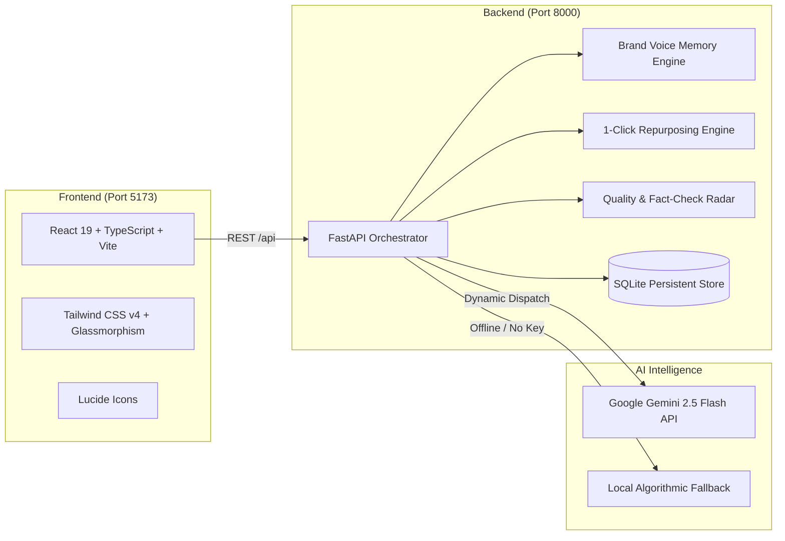

# Writara — AI-Powered Content Generation Platform

> **Transform ideas, prompts, and keywords into high-impact, brand-aligned digital content in seconds.**

Writara is a next-generation generative AI content operating system designed for creators, marketers, founders, and students. Instead of switching between multiple fragmented tools for brainstorming, drafting, rewriting, and optimizing, Writara provides a unified, intelligent workspace.

---

## 🌟 The 3 Signature Engines

Writara goes beyond basic prompt-to-text generation with three distinctive capabilities:

### 1. 🎙️ Brand Voice Memory
- **Reverse-Engineer Voice DNA:** Paste any sample article, company announcement, or brand guidelines. Writara automatically extracts your tone attributes, signature vocabulary, and banned buzzwords.
- **Persistent Persona Memory:** Apply saved brand personas across all future generations so your tone remains 100% consistent across every team member and campaign.

### 2. 🔁 One-Click Multi-Platform Repurposing
- Transform a single master asset (blog post, transcript, brief) into **6 channel-native formats simultaneously**:
  - **LinkedIn Thought Leadership Post** (concise line breaks, bold hook, engagement prompt)
  - **X / Twitter Thread** (numbered breakdown with viral pacing)
  - **Instagram Carousel & Caption** (slide-by-slide outline + curated hashtags)
  - **Email Newsletter** (subject line, preview text, personal narrative, CTA)
  - **Viral Reel / TikTok Script** (timestamped visual cues and voiceover)
  - **Executive Summary / Brief** (core context, bullet points, strategic next steps)
- 1-click copy, individual editing, or **Export All 6 Formats** in a combined Markdown pack.

### 3. 🔍 AI Content Quality & Fact Audit
- **Flesch-Kincaid Readability Analysis:** Real-time Reading Ease score (0–100), Grade Level, and sentence cadence metrics.
- **Multi-Vector Adherence Scoring:** Measures prompt adherence %, tone alignment %, and clarity index.
- **Anti-Hallucination Fact Radar:** Automatically flags ungrounded statistics, numerical assertions, and superlative claims with verification recommendations before publication.
- **SEO Keyword Density Table:** Analyzes top keywords and distribution.

---

## 🚀 Core Features & Modules

- **AI Content Generator Studio:** Prompt-engineered generation for Blog Articles, Social Captions, Marketing Newsletters, E-Commerce Product Descriptions, High-Conversion Ad Copy (AIDA & PAS), and Video Scripts.
- **Smart AI Writing Assistant & Editor:** Inline transformations including *Rewrite & Polish*, *Shorten & Tighten*, *Expand & Deepen*, *Fix Grammar*, *Summarize*, and *Multilingual Translation*.
- **Workspace & Project Folders:** Organize drafts into categorized folders, filter by tags, and track cumulative words generated and estimated hours saved.
- **Flexible Engine Support:** Integrates seamlessly with **Google Gemini 2.5 Flash** (via API key input or environment variable), and includes a built-in high-fidelity local algorithmic engine so you can test all features offline out-of-the-box.

---

## 🛠️ Architecture & Tech Stack



- **Frontend:** React 19, TypeScript, Vite, Tailwind CSS v4, Lucide React
- **Backend:** Python 3.13, FastAPI, Uvicorn, SQLite3, Pydantic v2, HTTPX
- **Database:** Local SQLite (`backend/writara.db`) with automatic table initialization and migrations
- **AI Models:** Google Gemini 2.5 / 2.0 / 1.5 Flash + Local Algorithmic Generation Fallback

---

## ⚡ Quick Start Guide

### 1. Launch Everything in 1-Click (Windows)
Double-click `run-writara.bat` or run:
```powershell
.\run-writara.ps1
```
This automatically starts:
- **Backend API:** `http://127.0.0.1:8000` (Interactive docs: `http://127.0.0.1:8000/docs`)
- **Frontend Web App:** `http://localhost:5173`

---

### 2. Manual Start

#### Backend Setup
```bash
cd backend
python -m venv venv
# Windows:
.\venv\Scripts\activate
# Linux/macOS:
source venv/bin/activate

pip install -r requirements.txt
python -m uvicorn main:app --host 127.0.0.1 --port 8000 --reload
```

#### Frontend Setup
```bash
cd frontend
npm install
npm run dev
```

Open `http://localhost:5173` in your browser.

---

## 🔑 Optional: Configuring Your Gemini API Key

1. Click **API Settings** in the top navigation bar.
2. Enter your Google Gemini API key (get one free at [aistudio.google.com](https://aistudio.google.com/app/apikey)).
3. Click **Save Configuration**.
*(If no key is entered, Writara will automatically use its built-in local engine so you can explore all features immediately.)*

---

## 📂 Project Structure

```
Writara/
├── run-writara.bat           # 1-click Windows launcher
├── run-writara.ps1           # PowerShell dual runner
├── README.md                 # Full documentation
├── backend/
│   ├── main.py               # FastAPI application & API endpoints
│   ├── database.py           # SQLite connection & schema initialization
│   ├── models.py             # Pydantic request & response schemas
│   ├── requirements.txt      # Python dependencies
│   └── services/
│       └── ai_service.py     # Gemini client, mock fallback, Flesch metrics, fact radar
└── frontend/
    ├── package.json          # Node dependencies
    ├── vite.config.ts        # Vite + Tailwind + Proxy configuration
    ├── src/
    │   ├── App.tsx           # Main application shell & tab routing
    │   ├── types.ts          # TypeScript interfaces
    │   ├── services/api.ts   # API client methods
    │   ├── data/templates.ts # Curated prompt template library
    │   ├── components/       # Navbar, Sidebar, ApiKeyModal
    │   └── views/            # Dashboard, Generator, Editor, Repurposer, BrandVoice, Evaluator, Documents
```

---

## 📜 License
MIT License. Built with ❤️ for creators and innovators worldwide.
