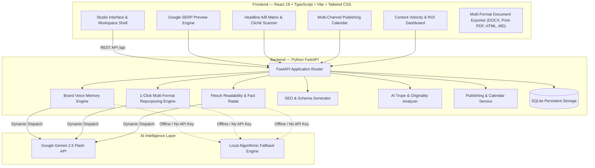

# Writara — AI-Powered Content Generation Platform

> **Transform ideas, prompts, and raw briefs into high-impact, brand-aligned digital content in seconds.**

Writara is a unified, next-generation generative AI content operating system designed for creators, digital marketers, entrepreneurs, students, and businesses. Instead of switching between fragmented tools for brainstorming, drafting, SEO optimization, rewriting, and scheduling, users perform the entire content lifecycle in one cohesive workspace.

---

## 🌟 The 3 Signature Engines

Writara goes beyond simple prompt-to-text generation by introducing three signature capabilities:

### 1. 🎙️ Brand Voice Memory
- **Reverse-Engineer Voice DNA:** Paste any sample article, company announcement, or brand guidelines. Writara decodes your tone attributes (*Visionary, Action-oriented, Direct*), signature vocabulary, and banned buzzwords (*synergy, game-changer*).
- **Persistent Persona Memory:** Apply saved brand personas across all future generations so your tone remains 100% consistent across every team member and campaign.

### 2. 🔁 One-Click Multi-Platform Repurposing
- Transform a single master asset (blog post, transcript, brief) into **6 channel-native formats simultaneously**:
  - **LinkedIn Thought Leadership Post** (concise line breaks, bold hook, engagement prompt)
  - **X / Twitter Thread** (numbered breakdown with viral pacing)
  - **Instagram Carousel & Caption** (slide-by-slide outline + curated hashtags)
  - **Email Newsletter** (subject line, preview text, personal narrative, CTA)
  - **Viral Reel / TikTok Script** (timestamped visual cues and voiceover)
  - **Executive Summary / Brief** (core context, bullet points, strategic next steps)
- 1-click copy, individual editing, or **Export All 6 Formats** in a combined Markdown pack.

### 3. 🔍 AI Content Quality & Anti-Hallucination Fact Audit
- **Flesch-Kincaid Readability Analysis:** Real-time Reading Ease score (0–100), Grade Level, and sentence cadence metrics.
- **Multi-Vector Adherence Scoring:** Measures prompt adherence %, tone alignment %, and clarity index.
- **Anti-Hallucination Fact Radar:** Automatically scans the draft for ungrounded statistics, numerical assertions, and superlative claims with verification recommendations before publication.
- **SEO Keyword Density Table:** Analyzes keyword density and structural placement.

---

## 🚀 Complete Platform Modules

| Module | Purpose | Highlights |
| :--- | :--- | :--- |
| **1. AI Generator Studio** | Structured Prompt-to-Content | Long-form blog posts, social captions, newsletters, e-commerce listings, AIDA/PAS ad copy, and video scripts. |
| **2. Smart Writing Assistant** | Precision In-Line Refinements | *Rewrite & Polish*, *Shorten & Tighten*, *Expand & Deepen*, *Fix Grammar*, *Summarize*, *Tone Shift*, and *Translation*. |
| **3. 1-Click Repurposer** | Multi-Channel Distribution | Turns 1 piece of content into 6 platform-native assets simultaneously. |
| **4. Brand Voice Memory** | Persistent Brand Persona | Trains on writing samples; enforces vocabulary & banned words. |
| **5. AI Quality & Fact Audit** | Content Verification | Flesch readability, fact-checking radar, and tone consistency audit. |
| **6. SEO & Google SERP Suite** | Organic Search Visibility | Live desktop/mobile Google snippet simulator, keyword matrix, and Schema.org JSON-LD generation. |
| **7. Headline A/B Matrix** | Viral Click-Through Optimization | Generates 5 distinct angles (*How-To, Contrarian, Numbers, FOMO, Transformation*) with estimated CTR potential scores. |
| **8. AI Cliché Scanner** | Human Tone & Originality | Flags robotic tropes (*"In today's fast-paced world"*, *"delve into"*, *"testament to"*) and suggests natural human replacements. |
| **9. Multi-Channel Calendar** | Publishing Scheduler | Visual schedule grid across LinkedIn, Twitter, Instagram, Email, Blog, and YouTube with status management (*Draft, Scheduled, Published*). |
| **10. Content Velocity Dashboard** | Analytics & ROI Tracking | Tracks total words generated, hours saved, and estimated financial ROI calculated at $0.15/word professional copywriter rates. |
| **11. Multi-Format Exporter** | Universal Publishing | Instant export to **Word DOCX**, **Print-to-PDF**, **Standalone HTML**, **Markdown**, and **Plain Text**. |

---

## 🛠️ System Architecture



---

## 📡 REST API Reference

| Endpoint | Method | Description |
| :--- | :--- | :--- |
| `/api/health` | `GET` | Health check and platform version status. |
| `/api/generate` | `POST` | Core content generation with brand voice constraints & prompt engineering. |
| `/api/edit` | `POST` | Smart assistant actions: rewrite, shorten, expand, grammar, summarize, translate. |
| `/api/repurpose` | `POST` | 1-click repurposing into LinkedIn, Twitter thread, IG, Newsletter, Video Script, Executive Brief. |
| `/api/evaluate` | `POST` | Comprehensive quality audit: Flesch metrics, prompt adherence, fact radar. |
| `/api/seo/analyze` | `POST` | Google SERP simulator, keyword prominence matrix, and Schema.org JSON-LD generation. |
| `/api/headlines/ab-test`| `POST` | Generates 5 high-converting headline variations with CTR prediction scores. |
| `/api/cliches/scan` | `POST` | Scans text for robotic AI tropes and computes originality score. |
| `/api/brand-voice` | `GET`, `POST` | List and create persistent brand voice profiles. |
| `/api/brand-voice/analyze` | `POST` | Reverse-engineers tone DNA, rules, and banned vocabulary from sample text. |
| `/api/documents` | `GET`, `POST`, `PUT`, `DELETE` | Workspace drafts, filtering by project, tags, and search query. |
| `/api/projects` | `GET`, `POST` | Workspace project folders for organizing campaigns. |
| `/api/calendar/posts` | `GET`, `POST`, `PUT`, `DELETE` | Multi-channel content calendar and publishing schedule CRUD. |
| `/api/analytics` | `GET` | Velocity metrics, hours saved, and copywriter cost ROI. |

---

## ⚡ Quick Start

### Option A: 1-Click Launch (Windows)
Double-click `run-writara.bat` or run in PowerShell:
```powershell
.\run-writara.ps1
```
This automatically starts:
- **Frontend App:** [http://127.0.0.1:5173](http://127.0.0.1:5173)
- **Backend API:** [http://127.0.0.1:8000](http://127.0.0.1:8000)
- **Interactive Swagger Docs:** [http://127.0.0.1:8000/docs](http://127.0.0.1:8000/docs)

---

### Option B: Manual Setup

#### 1. Backend Setup
```bash
cd backend
python -m venv venv
# Windows:
.\venv\Scripts\activate
# Linux/macOS:
source venv/bin/activate

pip install -r requirements.txt
python -m uvicorn main:app --host 127.0.0.1 --port 8000 --reload
```

#### 2. Frontend Setup
```bash
cd frontend
npm install
npm run dev
```

Open **[http://localhost:5173](http://localhost:5173)** in your browser.

---

## 🔑 Optional: Configuring Your Gemini API Key

1. Click **API Settings** in the top navigation bar.
2. Enter your Google Gemini API key (obtainable at [aistudio.google.com](https://aistudio.google.com/app/apikey)).
3. Click **Save Configuration**.
*(If no key is entered, Writara will automatically use its built-in local engine so you can explore all features immediately without any configuration.)*

---

## 📜 License
MIT License. Built with ❤️ for creators, marketers, and developers worldwide.
